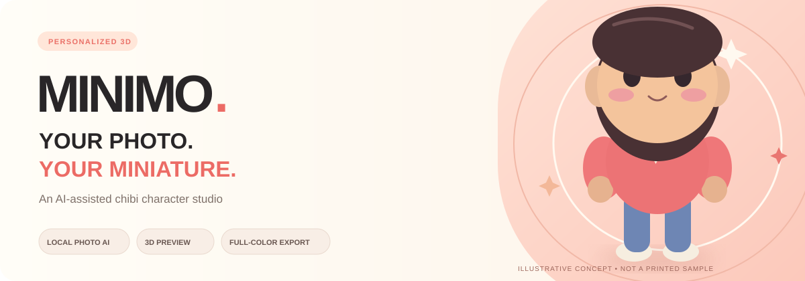

# MINIMO Studio
### AI-Assisted Photo-to-Chibi 3D Miniature Platform

**One photo. Your colors. Your little 3D world.**

Design a personalized, cute cartoon miniature with on-device photo analysis, interactive 360° preview, customization, regeneration, approval, and a full-color manufacturing handoff.

 

 

**[Live customer website](https://minimo-3d-printing.vercel.app/)** · **[Architecture](docs/ARCHITECTURE.md)** · **[Printing QA](docs/PRINTING-QA.md)** · **[Go-live requirements](docs/GO-LIVE.md)**

---

> [!IMPORTANT]
> **Current maturity: publicly deployed interactive design studio, not a paid production store.** The model generator, editor, 3D preview, regeneration, session-level approval, and production-*candidate* export are implemented. Paid checkout, durable orders, customer/admin authentication, supplier-approved printer files and physical print validation **are not yet completed**. Please do not advertise this release as an automated photo-perfect 3D reconstruction service.

## Project vision

MINIMO Studio aims to make personalized **full-color chibi figurines** accessible through a delightful web experience—without asking customers to learn 3D modeling, buy equipment or install a mobile app.

The intended journey is simple: **upload one photo → create a cute 3D version → inspect/adjust/regenerate → approve → order a professionally verified physical print**.

Our current release demonstrates the design and export stages. The secure order-processing and manufacturing pipeline is the next commercial milestone.

### What makes the approach practical?

| Pillar | Product decision | Benefit |
|:--|:--|:--|
| **One-photo entry** | Customer starts with a JPG, PNG or WebP photo | Fast onboarding |
| **CPU-friendly creation** | Browser-based parametric geometry + optional MediaPipe CPU landmarks | No dedicated GPU requirement for the starter workflow |
| **Color personalization** | Photo-region colors, plus editable skin/hair/clothing swatches | Keeps visible outfit and appearance colors recognizable |
| **Design control** | Hairstyles, poses, styles, sizes, regeneration | Customer can review before approving |
| **Actual 3D** | Rotatable, zoomable Three.js mesh | More informative than a static AI picture |
| **Production handoff** | GLB + OBJ/MTL/PNG + manifest | A concrete input for operator and supplier checks |

## Animated customer-to-print journey

**UPLOAD → CUSTOMIZE → APPROVE → REVIEW**

| Stage | Customer interaction | System responsibility |
|:--:|:--|:--|
| **01** | Upload one clear photograph | Validate image locally; sample skin, hair and clothing colors |
| **02** | Select chibi style; edit hairstyle, pose and colors | Optional AI landmarks + procedural 3D character generation |
| **03** | Rotate, zoom, regenerate or approve | Display and version the exact previewed model; invalidate approval after an edit |
| **04** | Export the approved design | Package a full-color printing **candidate** for manual mesh/color QA and supplier proofing |

**Try it now:** [Live 3D customization studio](https://minimo-3d-printing.vercel.app/#studio)

## Features & implementation status

| Module | Implemented capability | Status |
|:--|:--|:--:|
| Landing experience | Professional responsive homepage, sections and animated character | ✅ |
| Photograph intake | Click/drag-and-drop JPG, PNG, WebP, maximum 8 MB | ✅ |
| Face analysis | Optional on-device MediaPipe CPU face landmarks, with graceful fallback | ✅ |
| Color sampling | Approximate skin, hair, shirt and trousers colors from visible regions | ✅ |
| 3D character engine | Procedural chibi head/body, expressions, hair, shoes, outfits | ✅ |
| Style presets | Classic, Dreamy and Collector | ✅ |
| Customer editor | Hairstyle, pose, four color swatches, 5/8/10 cm sizes, inscription field | ✅ |
| Live preview | Real Three.js 3D, rotate and zoom | ✅ |
| Regeneration | Change procedural variation, preserve selected colors, bump version | ✅ |
| Approval state | Lock selected configuration for export during current browser session | ✅ |
| Export | GLB preview, OBJ/MTL/PNG textures, JSON order manifest in ZIP | ⚠️ Print candidate |
| Price presentation | Example target retail price in KRW | ℹ️ Indicative |
| Persistent customer orders | Database-backed history, accounts, order status | ❌ Pending |
| Secure admin dashboard | Operator review queue, roles, audit and notifications | ❌ Pending |
| Online payment | Payment gateway, server-verified checkout, webhooks | ❌ Pending |
| Printer-validated manufacture | Watertight final mesh, supplier color proof, first physical sample | ❌ Pending |

> [!NOTE]
> The current 3D engine is **template/procedural-based**. The optional AI component performs facial landmark analysis; the color picker performs pixel sampling. This is **not** an end-to-end diffusion model that recreates an exact person from one photograph. Hidden surfaces, face likeness, garments and patterns require estimation and human review.

## System architecture

~~~mermaid
flowchart TB
    Photo["Customer photograph"] --> Upload["Browser file validation"]
    Upload --> Colors["Canvas color estimation"]
    Upload --> Landmarks["Optional CPU face landmarks"]
    Colors --> Parameters["Editable character parameters"]
    Landmarks --> Parameters
    Manual["Style / hair / pose / size controls"] --> Parameters
    Parameters --> Engine["Procedural 3D chibi engine"]
    Engine --> Viewer["Three.js animated 360° preview"]
    Viewer --> Review{"Customer approves?"}
    Review -->|"Regenerate or edit"| Parameters
    Review -->|"Yes"| Snapshot["Session-level design snapshot"]
    Snapshot --> Exports["GLB + OBJ / MTL / PNG + manifest ZIP"]
    Exports --> Operator["Human mesh & color validation"]
    Operator --> Supplier["Full-color print supplier proof"]
    Supplier --> Product["Approved physical miniature"]
    style Photo fill:#ffe4d5,stroke:#d69c87,color:#312a27
    style Engine fill:#f8d2c8,stroke:#d78779,color:#312a27
    style Viewer fill:#e5daf0,stroke:#b6a0cc,color:#312a27
    style Exports fill:#e4eefa,stroke:#9ab4d0,color:#312a27
    style Product fill:#e0f2e7,stroke:#8bbda0,color:#24503b
~~~

### Technology stack

| Layer | Technologies | Function |
|:--|:--|:--|
| Website | HTML5, CSS3, ES modules | Lightweight responsive site |
| 3D engine | Three.js r170, OrbitControls | Procedural meshes and live 3D |
| Vision | MediaPipe FaceLandmarker, CPU/WASM (optional) | Basic face proportion estimates |
| Color analysis | Browser Canvas | Approximate color sampling |
| Packaging | GLTFExporter, OBJ/MTL, PNG, JSZip | Preview and print-candidate ZIP |
| Deployment | Vercel static hosting | Production HTTPS site |
| Python backend | FastAPI, Python worker, SQLite, trimesh | Implemented as a separate local/self-hosted service; not yet hosted |
| Future commerce | Hosted payments, verified accounts, order database, shipping | Not yet active |

Explore the complete [architecture documentation](docs/ARCHITECTURE.md), including trust boundaries and a proposed commerce service.

## Repository structure

~~~text
3D-printing/
├── index.html                     # Customer-facing experience
├── styles.css                     # Responsive design system and animation
├── app.js                         # Photo analysis, 3D generator, viewer, exporter
├── package.json                   # Test scripts
├── vercel.json                    # Static deployment and security headers
├── tests/
│   └── smoke.test.js              # Source-structure smoke tests
├── docs/
│   ├── ARCHITECTURE.md            # Engineering architecture and future services
│   ├── PRINTING-QA.md             # Manufacturing quality checklist
│   ├── GO-LIVE.md                 # Commercial release gates
│   └── assets/
│       ├── minimo-hero.svg       # Animated project header
│       └── customer-workflow.svg # Animated customer workflow
├── LICENSE                        # Proprietary license
└── README.md
~~~

## Quick start

### Requirements

A modern WebGL-enabled browser, Python 3 or equivalent HTTP server, and internet access for the current CDN-hosted JavaScript and optional AI model. An integrated GPU supporting WebGL is enough for the preview; a **dedicated** GPU is not required.

~~~bash
git clone https://github.com/hossain0707/3D-printing.git
cd 3D-printing

# Serve ES modules over HTTP (do not open index.html via file://)
python -m http.server 8000
~~~

Open **http://localhost:8000/**.

### Run automated smoke checks

~~~bash
npm test
# Alternative: node --test tests/smoke.test.js
~~~

The smoke test verifies essential files and source hooks, not full browser functionality, printable mesh integrity or live customer payments.

### Deploy to Vercel

1. Import the repository into Vercel with GitHub access enabled.
2. Use **Other / Static**, set the root directory to the repository root, and leave the build command empty.
3. Deploy the main branch and verify 3D preview and export.
4. For your own production use, connect Vercel Git integration so future GitHub commits trigger updates.

**Current public deployment:** **https://minimo-3d-printing.vercel.app/**. This deployment is online, but automatic GitHub-to-Vercel synchronization has **not yet been configured** for this repo.

## Python processing and operator workflow

The repository now includes a **real Python service**, a private persistence layer, an independent CPU worker, and an operator review interface. It is **not yet deployed to a public server**; the existing Vercel website remains a local-browser demo until you configure an HTTPS API URL.

| Python subsystem | Implementation |
|:--|:--|
| HTTP API | FastAPI with strictly validated requests |
| Private photo intake | MIME and image decoding checks, 8 MB limit, EXIF-stripped JPEG storage |
| Owner access | Per-project random tokens, server-side HMAC token hashes |
| Persistent job records | SQLite WAL on a dedicated persistent disk; single-host design |
| Generation queue | Separate resumable CPU worker process |
| Chibi geometry | Python + NumPy + trimesh (not pretrained photo-to-3D reconstruction) |
| Export | GLB + metric OBJ/MTL/flat-color PNGs + manifest ZIP |
| Server approval | Owner-token-protected selected version |
| Operator management | Admin-key-protected queue, version download and status transitions |
| Privacy | Project deletion endpoint, per-project access, private artifact storage |
| Manufacturing QA | Blender diagnostics CLI; manual geometry repair and material proof still required |

### Running the Python service

**Recommended:** use Docker Compose with a persistent named volume:

~~~bash
cp .env.example .env
# Configure both secrets in .env using 32+ random characters.
# Keep public generation disabled until you secure the deployment and consent flow.
docker compose up --build -d
docker compose logs -f worker
~~~

The service binds to **127.0.0.1:8001** on the host; place it behind an HTTPS reverse proxy when publishing it. Do not run this disk-backed job queue inside ephemeral Vercel Functions.

**Detailed setup:** [Python Backend Operations](docs/PYTHON-BACKEND.md).

### Connecting the live website

The frontend reads \`window.MINIMO_API_URL\` from [\`api-config.js\`](api-config.js). This defaults to an empty string, so the hosted website continues to use the browser-only demonstration until the backend exists.

Once you have a **real HTTPS API hostname**, set that public API **origin only** in \`api-config.js\`, configure the backend CORS allowlist for the customer website, and redeploy the static website. Never expose operator credentials or server secrets there.

With Python connected, the customer can select **Generate with Python**, inspect the server-generated GLB preview, approve that version via the API, and download the server-generated manufacturing ZIP. The worker must be running.

**Operator console:** [\`/admin.html\`](https://minimo-3d-printing.vercel.app/admin.html), available as a static interface but nonfunctional without a Python API URL and a private operator key. It does not process payments.

> [!WARNING]
> The Python worker is **CPU-first and template-based**. A local Python backend does not magically infer hidden anatomy, detailed clothing texture or exact customer likeness. The exported model is a **print candidate**, not a factory-approved product. Validation, payment, secure order checkout, backup/retention policies, real full-color samples and fulfillment remain launch gates.

## Manufacturing handoff

A customer-approved browser design can be exported as:

~~~text
minimo-approved-v{version}-{size}mm.zip
├── ORDER-MANIFEST.json
├── READ-BEFORE-PRINTING.txt
├── preview/
│   └── approved-character.glb
└── print-candidate/
    ├── miniature.obj
    ├── miniature.mtl
    └── color_<hex>.png  # One or more generated texture maps
~~~

| Asset | Purpose |
|:--|:--|
| GLB | Reviewable digital character |
| OBJ | Mesh candidate scaled to target height in millimeters |
| MTL / PNG | Flat-color material texture assignments |
| Manifest | Chosen parameters, approved version, identifier and status |
| Print instructions | Manual repair, supplier validation and color-proof requirements |

> [!CAUTION]
> **Do not treat the generated ZIP as a certified printable object.** Some meshes overlap and may require Boolean union/voxel remeshing, manifold inspection, support/thickness fixes and UV rework. Solid-color textures do not reproduce exact clothing prints or photo-realistic skin, and actual color depends on the printer's process and material. An external printing supplier must accept the corrected file before customer fulfillment.

**Operator reference:** [Full-Color Printing Quality Assurance](docs/PRINTING-QA.md).

## Privacy, reliability & trust

- Photos are processed **in the browser** and are not uploaded to a dedicated MINIMO server in the current release.
- Third-party CDN libraries and optional landmark-model files are downloaded to run locally; audit and self-host them for commercial use.
- Current approval history is **session-only**, not a persistent authenticated order.
- Never store customer photos or addresses in the public GitHub repository.
- Before commercial launch: implement authentication, role separation, private object storage, rate limits, consent/retention rules, server-side pricing, verified payment events, audit logs and operational monitoring.
- Confirm customer permission to use likenesses, logos, copyrighted outfits or other protected assets.

## Version roadmap

~~~mermaid
flowchart LR
    V1["V1 • Interactive studio Deployed"] --> V2["V2 • Export Candidate implemented"]
    V2 --> V3["V3 • Orders / payment / admin Not connected"]
    V3 --> V4["V4 • High-fidelity AI / auto QA Research"]
    style V1 fill:#ddf4e5,stroke:#8dbfa0,color:#2d5236
    style V2 fill:#fff1d9,stroke:#d6ae60,color:#675029
    style V3 fill:#f8e3e4,stroke:#d5969b,color:#682e36
    style V4 fill:#e7e9f8,stroke:#a4b1d7,color:#303d6e
~~~

| Phase | Delivered / required outcome | Status |
|:--|:--|:--|
| **V1 — Experience** | Online UI, live 3D customization, regeneration and design approval | ✅ Deployed |
| **V2 — Export** | Colored candidate bundle; mesh repair and real full-color sample still required | 🟡 Partial |
| **V3 — Commerce** | Authenticated customers/operators, paid checkout, durable orders, status and shipping | ⏳ Planned |
| **V4 — Fidelity** | Better segmentation, texture synthesis, validated likeness and automated print QA | 🔬 Research |

### Before the first paid customer order

1. Validate photo color/shape accuracy with varied real client images.
2. Confirm that ZIP export completes and imports with correct scale and textures in Blender.
3. Repair meshes to match the selected full-color printer's requirements.
4. Produce and inspect physical test prints before advertising delivery quality.
5. Integrate secured orders, payments, administration, customer privacy and fulfillment.
6. Complete applicable business, consumer-protection and immigration/work-authorization checks.

See [the full commercial launch checklist](docs/GO-LIVE.md).

## License & ownership

**© 2026 Md Najmul Hossain — All rights reserved.**

This repository's original code, design, documentation, brand artwork and modeling workflow are proprietary. Commercial use, redistributing or deriving from these original assets requires permission. See [LICENSE](LICENSE). Third-party libraries and customer-owned materials remain under their respective rights.

**Maintainer:** [Md Najmul Hossain · @hossain0707](https://github.com/hossain0707)

---

### Small figure. Big personality.

**[Launch the live studio](https://minimo-3d-printing.vercel.app/)** · **[Inspect the architecture](docs/ARCHITECTURE.md)** · **[Review manufacturing readiness](docs/PRINTING-QA.md)**

The animated README illustrations are concept artwork, not photographs of manufactured samples.

