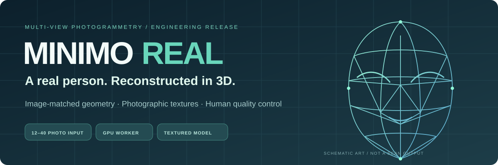

# MINIMO REAL
### Multi-View Human 3D Reconstruction & Manufacturing Preparation

**Real photographs. Real reconstructed geometry. No generic cartoon avatars.**

A professional, privacy-aware platform for generating textured, realistic 3D scans from multiple views of a person. Powered by Python, FastAPI, **COLMAP photogrammetry**, Blender automation, and a browser-based real-model viewer.

**[Customer capture](https://minimo-3d-printing.vercel.app/#capture)** · **[Architecture](docs/ARCHITECTURE.md)** · **[Deployment](docs/PYTHON-BACKEND.md)** · **[Capture quality](docs/PHOTO-CAPTURE.md)** · **[Print QA](docs/PRINTING-QA.md)**

---

> [!IMPORTANT]
> **Deployment and validation status:** The new realistic customer interface is deployed on Vercel, and Python API/job logic is covered by automated tests. **The GPU/COLMAP + Blender processing worker is not yet connected to a public service, and a full reconstruction with representative real-person photographs has not yet been validated.** Until an HTTPS Python processing service is provisioned, the website explicitly disables upload and never fabricates a 3D preview. There is **no live payment, printer fulfillment, or guaranteed photo-identical reconstruction**.

## Project objective

Produce an actual **photograph-derived 3D mesh and texture** of a real person for inspection, correction, and potential full-color printing. Unlike the earlier chibi prototype, the active application does not make a character from predefined spheres or faces.

- Customers provide **12–40 overlapping, consistent photographs** of one stationary person.
- The reconstruction pipeline estimates real camera geometry and dense surface detail.
- Multi-view image textures preserve information visible in the submitted photographs.
- The customer inspects a genuine GLB generated from the scan before approving it.
- The operator inspects the textured OBJ, physical scale, manifold boundaries, textures and vendor material rules before printing.

**This is a multi-photo photogrammetry system, not a magic single-image identity AI.** Face, hair and fine fabric are intrinsically difficult to reconstruct, especially if the person moves. A synchronized multi-camera capture may be needed for premium accuracy.

## Animated acquisition workflow

| Phase | Actual operation | Acceptance condition |
|:--|:--|:--|
| **Capture** | 12–40 real overlapping photos, upload consent and validation | Distinct decodable images with sufficient coverage |
| **Geometry** | COLMAP feature matching, camera mapping, dense PatchMatch, depth fusion, Poisson surface | Nonempty real mesh and a successful GPU pipeline |
| **Texture** | COLMAP projects photographed colors into a texture atlas | Actual OBJ, MTL and image textures exist |
| **Handoff** | Blender imports real mesh, normalizes scale and creates GLB/OBJ + QA JSON | Customer reviews real preview; operator checks manufacturing |

> [!NOTE]
> A texture atlas derived from the photographs is **not** a promise of photographic accuracy on the final physical object. Skin, hair, reflective material and partially unseen parts are difficult even for advanced photogrammetry.

## Current implementation

| Area | Implemented | Verified |
|:--|:--:|:--|
| Responsive realistic-capture website | Yes | Frontend source/CI |
| Secure 12–40 photo submission and validation | Yes | Python API tests |
| Explicit likeness consent | Yes | Python API tests |
| Owner-scoped private project token | Yes | Python API tests |
| Project retention and deletion | Yes | Python API tests |
| Durable queued jobs, worker stage reporting | Yes | Python API tests |
| Real COLMAP SfM/MVS/texture command pipeline | Yes | Command integration coded; **GPU sample run not verified** |
| Blender GLB + scaled textured OBJ export | Yes | Script implemented; **real scan/print not verified** |
| Web-based real GLB viewer | Yes | Static integration; **real server preview not verified** |
| Customer approval, private ZIP/report download | Yes | Python API contract tests |
| Restricted operator queue and production status | Yes | Python API contract tests |
| Actual payment and shipping | No | Not connected |
| Printer-certified model / physical first article | No | Requires supplier testing |
| Public GPU worker deployment | No | Dedicated GPU and HTTPS service required |

**No unfinished module returns fabricated success:** if the binaries are missing, photos do not match, geometry fails or files are incomplete, the job fails and the UI reports the failure.

## System architecture

~~~mermaid
flowchart LR
  A["Customer on Vercel"] --> B["12–40 photos + consent"]
  B --> C["Private FastAPI API"]
  C --> D["Authenticated project + SQLite"]
  C --> E["Restricted photo storage"]
  D --> F["Python durable worker"]
  E --> F
  F --> G["COLMAP CPU SfM"]
  G --> H["COLMAP GPU dense MVS"]
  H --> I["Poisson geometry + photo texture"]
  I --> J["Blender GLB / textured OBJ"]
  J --> K["Version + QA JSON + private ZIP"]
  K --> L["Customer 3D preview & approval"]
  K --> M["Operator geometry / material review"]
  M --> N["External printer, only after approval"]
  style C fill:#dff2e8,color:#15342d,stroke:#79b79e
  style H fill:#e2edfa,color:#203955,stroke:#9fb6d1
  style K fill:#fff0dc,color:#59432b,stroke:#e3b77b
~~~

**Operational separation:** Vercel serves the customer UI. The long-running GPU worker and private files **must run on a persistent host or dedicated processing service**, not inside Vercel's short-lived web functions.

## Repository layout

~~~text
3D-printing/
├── index.html                       Customer multi-photo capture and 3D review
├── styles.css                       Responsive design and animations
├── app.js                           Real authenticated upload, job monitor and GLB viewer
├── admin.html / admin.js            Private operator queue interface
├── api-config.js                    Public API ORIGIN only; no secrets
├── services/python/
│   ├── minimo/
│   │   ├── app.py                   FastAPI service / privacy / project authorization
│   │   ├── db.py                    Transactional single-host SQLite schema
│   │   ├── settings.py              Fail-closed security configuration
│   │   ├── photogrammetry.py         Real COLMAP stages, Blender handoff, ZIP validation
│   │   └── worker.py                Durable processing jobs and retention cleanup
│   ├── tests/test_api.py            API tests with synthetic test images
│   ├── requirements.txt
│   └── Dockerfile                   API container (worker requires GPU provision)
├── tools/blender/
│   └── prepare_realistic.py         Real textured mesh import, sizing, QA and export
├── docs/
│   ├── PYTHON-BACKEND.md            Running and deploying processing services
│   ├── PHOTO-CAPTURE.md             Multi-angle customer photography protocol
│   ├── ARCHITECTURE.md              Architecture and security boundaries
│   ├── PRINTING-QA.md               Manufacturing inspection
│   ├── GO-LIVE.md                   Exact launch gates and outstanding integration
│   └── assets/                      Animated technical README illustrations
├── compose.yaml                     Local API with private persistent storage
├── .github/workflows/ci.yml         Automated frontend and Python tests
└── LICENSE                          Proprietary original project rights
~~~

## Quick start

**Requirements:** Python 3.12, Node.js 22 (smoke tests), a modern WebGL browser, and for actual reconstruction a compatible **CUDA-enabled COLMAP installation and Blender 4.4+**.

### Launch the API locally

~~~bash
git clone https://github.com/hossain0707/3D-printing.git
cd 3D-printing
python -m venv .venv
source .venv/bin/activate
pip install -r services/python/requirements-dev.txt
cp .env.example .env
~~~

Create distinct cryptographically random secrets and configure your environment before starting. The API refuses public intake by default.

~~~bash
# Example Linux/macOS shell after exporting the configured environment:
export PYTHONPATH=services/python
uvicorn minimo.app:app --host 127.0.0.1 --port 8001
# In a second terminal, with COLMAP GPU and Blender installed:
python -m minimo.worker
# For the static website:
python -m http.server 8000
~~~

Alternatively use **\`docker compose up --build -d\` for the local API**. A separate GPU worker must still be installed on a machine that can access the same private persistent data volume; the API-only container does **not** include CUDA COLMAP or Blender.

Read **[Python backend deployment and security](docs/PYTHON-BACKEND.md)** for the exact startup, HTTPS, retention, GPU, and service requirements.

### Test

~~~bash
npm test
node --check app.js
python -m pytest services/python/tests -q
PYTHONPATH=services/python python -m minimo.preflight  # GPU host only
~~~

Tests validate input security and API contracts with **mocked external reconstruction**. They cannot verify actual likeness, CUDA throughput, supplier acceptance, or physical output. The CI badge should not be interpreted as certification.

### Connect the public customer website

After deploying a real Python API behind HTTPS, set **only the public HTTPS origin** in [api-config.js](api-config.js), update backend \`MINIMO_ALLOWED_ORIGINS\`, and deploy the static files to Vercel. Until then, the frontend remains a **truthful read-only demonstration of the capture experience**.

**Live website:** https://minimo-3d-printing.vercel.app/

**Private operator console:** https://minimo-3d-printing.vercel.app/admin.html — operates only when the Python API is available and an authenticated operator enters their private key.

## Reconstruction and print safety

The produced ZIP contains the **actual reconstructed scene**, photographic textures, an operator QA report, and manufacturing candidate. No customer photos are included in the distributed ZIP.

- The model has **unverified absolute physical scale** unless a calibrated reference is captured. The current automated sizing maps the longest reconstructed dimension to the chosen target height; an operator must correct orientation and confirm measurements.
- A reconstructed mesh may contain thin shells, holes, intersections or disconnected pieces.
- Hair and soft fabrics may require manual modeling or re-capture.
- Color fidelity depends on the printer, process, material, ICC workflow, finishing and lighting.
- The system **does not accept paid orders**, submit models to print vendors, or certify print quality.

Read [the printing quality checklist](docs/PRINTING-QA.md).

## Privacy and security

Human photographs can be sensitive personal data. The current API requires affirmative consent and stores images in a private server directory, not on Vercel or GitHub. Project access requires a random owner token, the database stores a keyed digest rather than the raw token, and data is retained for a configurable duration (default **30 days**). The customer can request deletion, and the worker purges expired completed projects.

Before activating uploads for the public internet, deploy TLS, access control, malware filtering, edge rate limits, server backups, monitoring, legally reviewed privacy/retention notices, breach response and a protected operator authentication system. **Do not put customer photos, project tokens or admin keys into GitHub or public JavaScript.**

## Release roadmap and real launch gates

| Release | Description | Status |
|:--|:--|:--|
| **R1** | Realistic capture UI + new FastAPI multi-image API | Implemented; tests added |
| **R2** | Real COLMAP + Blender pipeline | Implemented; GPU real-photo integration still unverified |
| **R3** | Hosted private GPU processor and customer preview | External hosting/integration required |
| **R4** | Measured likeness, repair workflow, supplier first articles | Physical validation required |
| **R5** | Protected commerce, payment verification and shipping | Not implemented |

**Do not sell a “photo-identical figure” until a representative pilot demonstrates it.** Validate multiple people and capture conditions with explicit user consent, inspect actual face likeness and ship at least one proofed full-color print.

## Technical sources and licensing

- [COLMAP command-line and photogrammetry reference](https://colmap.github.io/cli.html)
- [COLMAP source/license](https://github.com/colmap/colmap) — BSD-style open-source license.
- [Blender Python API](https://docs.blender.org/api/current/) — external processing tool with its own license.
- [Three.js](https://threejs.org/) — web visualization library.

Original MINIMO code, visual design, documentation and custom scripts remain **proprietary to Md Najmul Hossain**; third-party packages and toolchains retain their respective licenses. See [LICENSE](LICENSE).

---

**MINIMO REAL — your likeness deserves real geometry.**

[Open customer site](https://minimo-3d-printing.vercel.app/) · [Review capture requirements](docs/PHOTO-CAPTURE.md) · [Inspect source](https://github.com/hossain0707/3D-printing)

Technical SVG artwork illustrates the reconstruction process and is not presented as a customer scan.

