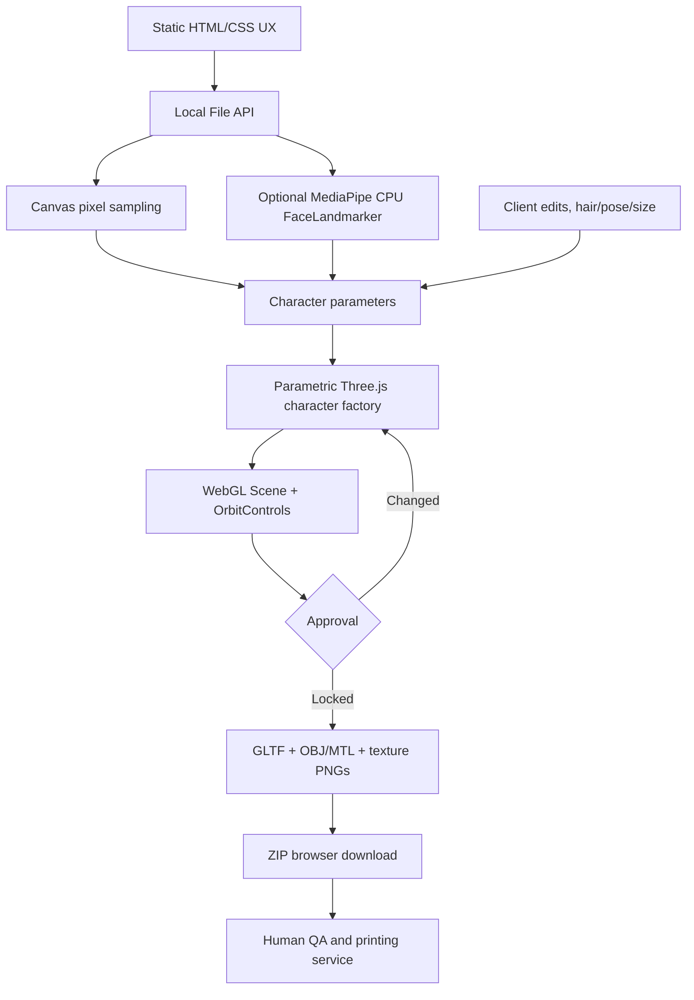
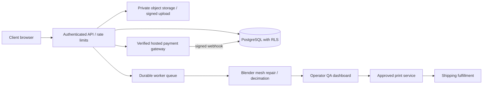

# System Architecture and Engineering Decisions

## Objectives
- One-photo, cute-colored 3D miniatures; zero required client installation.
- Accept commodity laptops without dedicated GPU by rendering with browser WebGL and running optional CPU landmarks.
- Preserve recognizable colors and customer-editable style controls.
- Lock the approved version and produce a transparent manufacturing handoff.
- Minimize operating costs and prevent false “printer-ready” or paid-order confirmations.

## Runtime diagram

## Current modules
- index.html: accessible single-page customer journey.
- styles.css: brand design system, animated cards, responsive layouts, reduced-motion rules.
- app.js: geometry factory, materials, optional AI landmarks, image pixel analysis, regeneration/version state, WebGL rendering, metric print-candidate exporter.
- vercel.json: static site and basic security headers.
- docs: explicit go-live gate, print checks, operational expectations.

## Local-first engineering details
1. The 3D geometry comes from reusable parameterized closed primitives, not a trained 3D generative model.
2. Image analysis estimates image colors by regions. Background contamination and lighting bias are expected. Users must review and edit.
3. FaceLandmarker is optional. If download or inference fails, the studio continues with region-based colors only.
4. Regeneration changes hairstyle fringe and the procedural design seed while preserving selected palette and controls.
5. Approval stores an in-memory snapshot, token and timestamp. It is **not a secure server-side order**.
6. Any edit invalidates approval, preventing inadvertent export of mismatched versions.
7. GLB is for visual preview. The OBJ/MTL/PNG package is a manufacturer-specific **candidate** that needs repair and validation.

## Planned V3 service architecture (NOT currently connected)

### Recommended tables (after selecting a dedicated backend)
- customers: id, email, verified status, created_at.
- projects: id, customer_id, source_asset_path, consent_at, created_at.
- versions: id, project_id, version_number, seed, model_asset_path, manifest, preview, created_at.
- orders: id, customer_id, approved_version_id, total_quote_krw, payment_state, production_state, shipping_state, created_at.
- audit_events: id, actor_id, object_type, object_id, event, timestamp.

### Mandatory controls before storing customer data
- Customer auth, operator/admin roles, verified rate limits, per-customer row ownership rules.
- Private object storage, scoped signed URLs, expiring access, upload size/type scanning.
- Server-validated pricing, server-authoritative order IDs, idempotent payment webhooks.
- No client-provided “paid” flag, no public write access to production state.
- Consent receipts, photo retention and deletion procedures, refund and cancellation policy.
- Async processing queue to handle long CPU work without web request timeouts.
- Live metrics, queue backpressure, alerts and backup restore tests.

## Scaling
- Early 20 orders: curated local workflow + third-party printing; be transparent that owner QA remains manual.
- 100+ orders: migrate to private storage and worker queue, add print profile validation.
- Automated job fulfillment only after physical sample testing and stable commercial contracts.

## Known limitations
- One photo cannot infer the back of a head, fine garment pattern or hidden features accurately.
- Vertex colors/material colors are not equivalent to a photo-realistic surface texture.
- Different full-color printer technologies give different finishing, strength and color gamut.
- Procedural meshes contain interpenetrating closed parts that may need Boolean unions / voxel remeshing.
- CDNs are current runtime dependencies; offline mode is not supported.
- Browser-only approval is not persisted across devices and cannot be trusted as an order record.

## Implemented Python service (new)

The Python code under `services/python/minimo/` adds a **separate self-hosted** FastAPI API, persistent project/version/job metadata, project tokens, a CPU geometry worker, and private zip/GLB delivery. It is deliberately absent from the static Vercel runtime until a separately managed server is deployed.

- `app.py`: validated photo intake, project authorization, queue creation, job polling, approvals, admin review, deletion.
- `worker.py`: durable job processing; interrupted running jobs are re-queued after a worker restart.
- `geometry.py`: NumPy/trimesh chibi mesh assembly, flat-color texture export, metric dimensions, GLB and OBJ/MTL/PNG.
- `db.py`: SQLite WAL and single-host schema.
- `settings.py`: fail-closed production secrets, allowed origins and disabled-by-default public generation.
- `admin.html`: browser-based operator console that requires a separate admin key.
- `tools/blender/inspect_print_candidate.py`: read-only mesh diagnostic report, *not* printer approval.

### Security and scaling limits

The current Python service is a strong **single-host foundation**, but cannot be called multi-region production infrastructure. It still needs HTTPS termination/WAF, trusted reverse-proxy headers, durable offsite backups, retention policy, operator key management/rotation, customer accounts, real payments and SQL migration tooling for scaling. SQLite + a single worker should **not** be used as a distributed queue.

See [Python Backend Operations](PYTHON-BACKEND.md).

